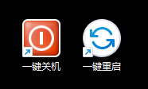

<div align="center">

<h1>FastShutdown</h1>

[](#)
[](#)
[](LICENSE)

> 在桌面创建「一键关机」和「一键重启」快捷方式

</div>

| 自动绑定 Windows 内置图标库 `SHELL32.dll` |
| --- |
|  |

## 功能

双击运行后，在当前用户桌面生成两个快捷方式：

| 快捷方式 | 目标 | 参数 |
| --- | --- | --- |
| 一键关机 | `%SystemRoot%\System32\shutdown.exe` | `-s -t 0` |
| 一键重启 | `%SystemRoot%\System32\shutdown.exe` | `-r -t 0` |

- 图标直接取自系统 `SHELL32.dll`（索引 27 / 238），无需附带图标文件
- 桌面路径读取注册表 `User Shell Folders`
- 已存在的同名快捷方式会被覆盖更新

## ⬇️ 下载使用

[](https://github.com/NeetheCheeBao/FastShutdown/releases)

## 🛠️ 本地编译

1. 克隆仓库到本地

```bash
git clone https://github.com/NeetheCheeBao/FastShutdown.git
```

或者

```bash
gh repo clone NeetheCheeBao/FastShutdown
```

2. 一键编译

```bat
.\build.bat
```

- 产物位置：`dist\FastShutdown.exe`

## 📁 项目结构

```text
FastShutdown
|   .gitignore
|   app.manifest        # 清单
|   app.rc              # 资源脚本：图标 + 清单
|   build.bat           # 一键编译脚本
|   LICENSE
|   main.cpp            # 全部实现：快捷方式创建与结果提示
|   README.md           # 项目说明
|   resource.h          # 资源 ID
|
+---assets
|       icon.ico        # 图标
|
\---screenshot          # 截图
        demo1.png
```

## ⚖️ 许可证

本项目采用 MIT 许可证 - 详情请参阅 [LICENSE](LICENSE) 文件。
